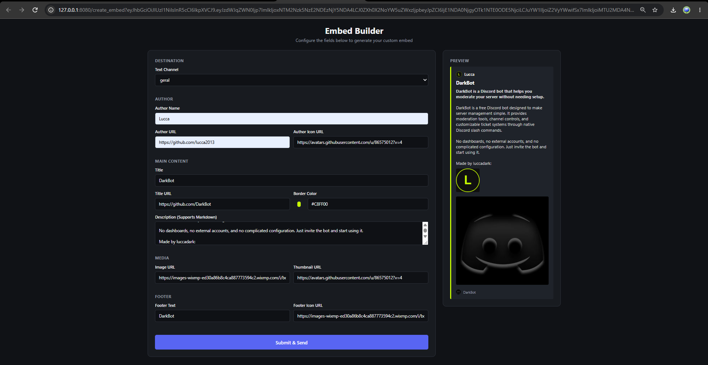
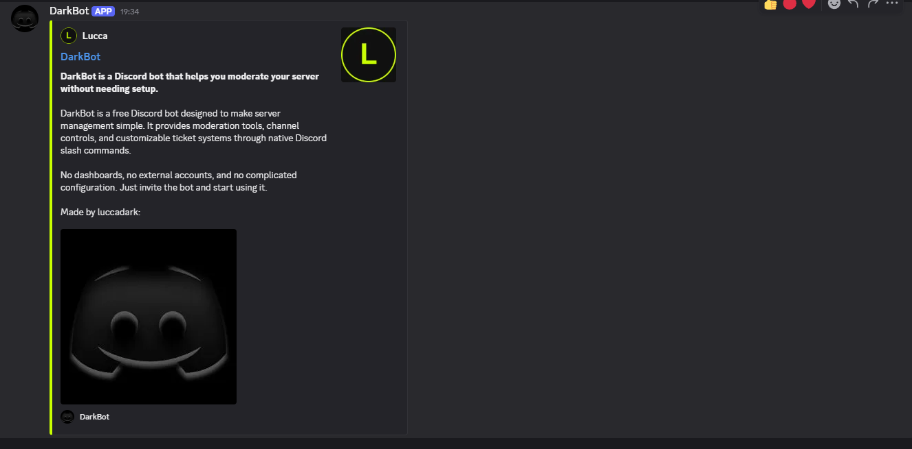
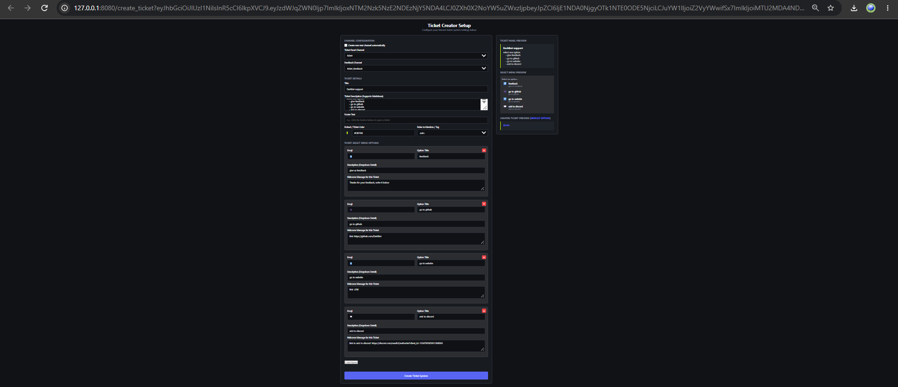
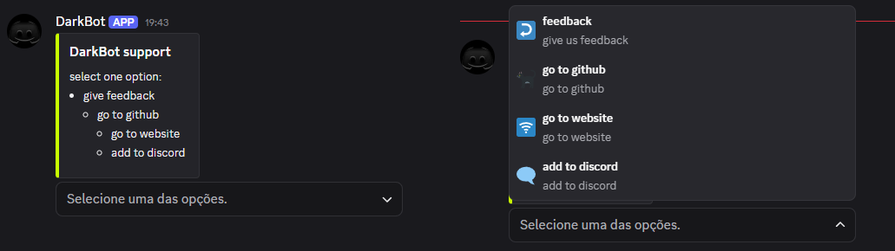
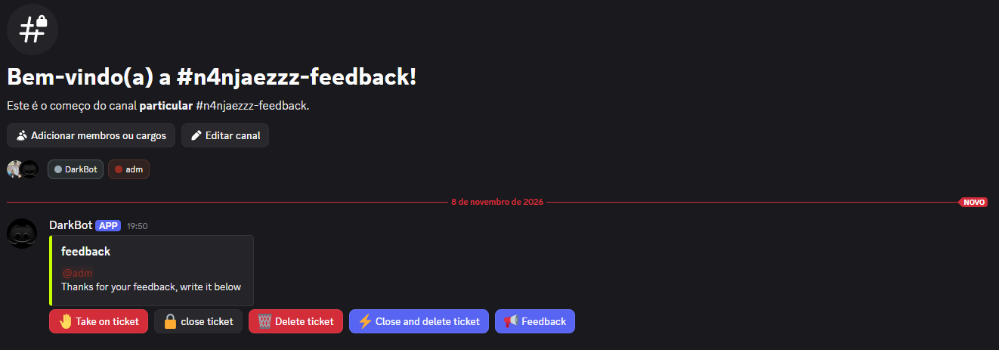
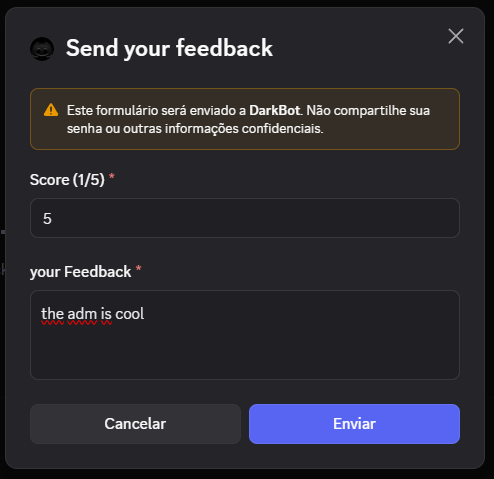
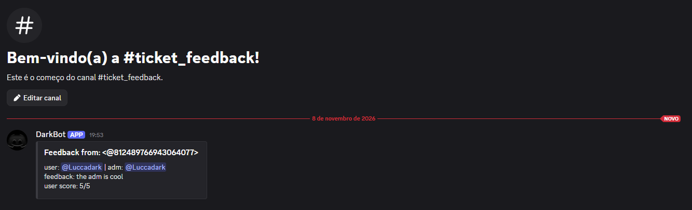

# DarkBot

**DarkBot is a Discord bot that helps you moderate your server without needing setup.**

DarkBot is a free Discord bot designed to make server management simple. It provides moderation tools, channel controls, and customizable ticket systems through native Discord slash commands.

No dashboards, no external accounts, and no complicated configuration. Just invite the bot and start using it.

## Features

- **Free forever** – All features are available without subscriptions or premium tiers.
- **No account required** – No registration or external login needed.
- **Slash commands** – Manage your server directly through Discord.
- **Moderation tools** – Ban users, manage timeouts, and review ban lists.
- **Channel management** – Lock and unlock text channels.
- **Custom embeds** – Create and customize Discord embeds through a private configuration page.
- **Ticket system** – Configure a ticket system with custom options, channels, roles, and feedback functionality.
- **Private configuration links** – Secure, temporary links generated directly through Discord.

## Commands

All commands are restricted to server administrators and use Discord's native slash command interface.

| Command | Description | Category |
|---|---|---|
| `/ping` | Check the bot's response latency. | Utility |
| `/lock` | Prevent members from sending messages in a channel. | Channels |
| `/unlock` | Allow members to send messages again. | Channels |
| `/ban` | Ban a member from the server. | Moderation |
| `/unban` | Unban a previously banned user. | Moderation |
| `/ban_list` | Display the server's ban list. | Moderation |
| `/timeout` | Temporarily restrict a member's ability to interact. | Moderation |
| `/embed` | Generate a private link to configure a custom embed. | Utility |
| `/ticket` | Generate a private link to configure a ticket system. | Utility |

## Embed & Ticket Configuration

DarkBot provides web-based configuration pages for more advanced features, without requiring users to create an account.

### Embed Creator

Use `/embed` to generate a private configuration link. From there, you can customize an embed and send it to any text channel in your server.

### Ticket Creator

Use `/ticket` to generate a private configuration link for your server's ticket system.

You can configure:

- Custom embed where users can read the description and select one option (you create the options).
- Ticket-opening system.
- Feedback system.
- Custom channel where users can open tickets.
- Custom channel for feedback (the feedback system is created automatically).
- Easy way to close and/or delete opened tickets.

## Screenshots & Preview

Explore DarkBot's features and see how they look inside Discord.

### Embed System

**Embed Creator**

Customize your Discord embeds using a private configuration page.

**Embed Preview**

See how your customized embed looks when sent to your Discord server.

### Ticket System

**Ticket Creator**

Configure your ticket system, customize its options, and choose how it will work on your server.

**Ticket Selection**

The embed sent to your server, allowing members to select the type of ticket they want to open.

**Opened Ticket**

Once a member selects an option, a ticket channel is created with management controls available to administrators.

### Feedback System

**Feedback Form**

Users can submit their feedback through a Discord modal.

**Feedback Result**

Submitted feedback is automatically sent to the configured feedback channel.

## Technologies

DarkBot is built using the following technologies:

| Technology | Purpose |
|---|---|
| [Python](https://www.python.org/) | Main programming language. |
| [discord.py](https://discordpy.readthedocs.io/) | Discord bot integration and slash commands. |
| [Flask](https://flask.palletsprojects.com/) | Web server and HTTP routes. |
| [JWT](https://jwt.io/) | Secure authentication and temporary configuration links. |
| HTML5 | Web page structure and configuration interfaces. |
| CSS3 | Styling and responsive layouts. |
| JavaScript | Client-side interactions and dynamic configuration. |

Flask is responsible for serving the HTML, CSS, and JavaScript files, as well as handling the configuration routes used by the bot.

## Security

DarkBot uses JWT to generate temporary configuration links for administrative actions.

- Configuration tokens expire after 60 minutes.
- Administrative commands require administrator permissions.
- No external user account is required.
- Sensitive credentials should be stored in environment variables and never committed to the repository.

## Creator

DarkBot is independently developed and maintained by **Luccadark (Lucca Felipetto)**.

- GitHub: [@lucca2013](https://github.com/lucca2013)
- Support the project: [Ko-fi](https://ko-fi.com/luccafelipetto)

---

  <strong>DarkBot — Free forever. Simple server management.</strong>
   
  Made by Luccadark.

